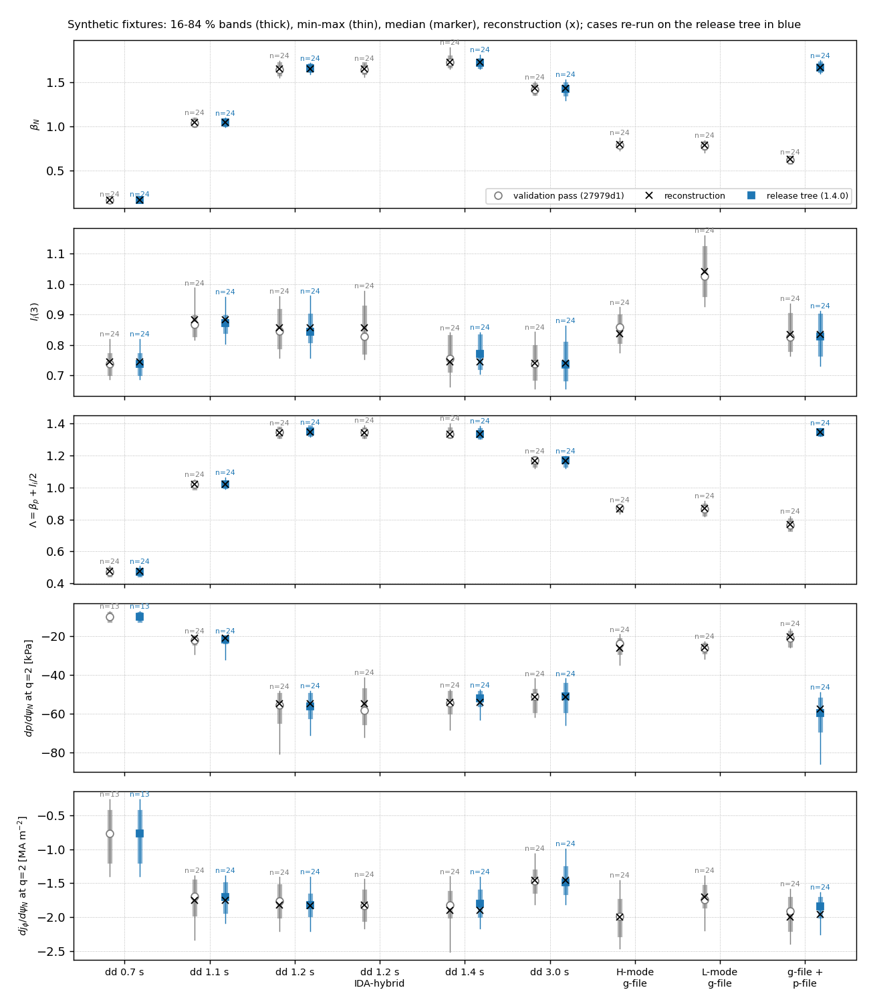

# Validation provenance (bouquet 1.4.0)

This page records what bouquet 1.4.0 was validated on, where, at which code
revisions, against which bars, and with what result, misses included. It
gives aggregate numbers only. The real-data cases are described by what they
are, not by identifiers. What did not pass is listed under
[Misses](#misses) and in [known-limitations.md](known-limitations.md).

## Where and how

- **Host.** All runs used a shared validation host. Every run went through
  its batch scheduler, requesting the job's real core count. Each solver ran
  on one thread (`nthreads=1`, BLAS pinned), so every solve is
  bit-reproducible. The OpenFUSION Toolkit build was `20260929_7da4f18`
  (upstream) everywhere except the experimental `swb` stage, which needs a
  fork build (`20261009`).
- **Isolation.** Every run started from a fresh, clean clone at the stated
  commit. No run made a network attempt: the data-fetching code was stubbed
  out and never called.
- **No bar moved.** No number below was obtained by changing a tolerance,
  gate, bar, iteration cap, pass ceiling, band, filter, cut, attempt cap,
  in-spec target, runtime target, seed or coil bound. No input was smoothed
  or clipped. The library's own default kinetic clips are part of the code
  under test, and their counts are reported.

## Revisions

| main revision | what it is | what ran there |
|---|---|---|
| `49ebebb` | the thermal-only synthetic H-mode g-file; the in-spec rule's archived verdict | the full real-data ladder; all three goldens regenerated; the synthetic ensembles (v3) |
| `27979d1` | adds the boundary constraint at a constant total with the reported partition, the homotopy's VSC bound floor, the per-draw wall budget, and the kinetic clips on by default (PR #94) | the full ladder again; all three goldens regenerated; the synthetic ensembles (v4, the figure below); the solver suite |
| `8e095fe` | the release tree (PR #96): the dd route's total Z_eff, the p-file's beam pressure as `p_fast`, the legacy golden without the wall budget, one Z_eff rule on every route, review fixes | the IDS and legacy goldens regenerated; the synthetic dd and g-file + p-file ensembles re-run; the solver suite; the fast suite |

At `27979d1`, every engine reconstruction of the ladder is bit-identical to
`49ebebb` in l_i(3), q0, β_N, passes, solves and MSE χ². Only the reversed-I_p
control case's draws moved (the VSC floor, below).

The `8e095fe` changes act on three routes: the plain dd route, the g-file +
p-file route, and an opt-in IDA-hybrid sub-route. The real-data ladder runs
the measured IDA routes, and its g-file + p-file case sets its beam pressure
explicitly (an explicit `p_fast` still wins). The `27979d1` ladder rows
therefore stand for the release; they were not re-run.

## The acceptance ladder: rungs and bars

| rung | case (generic) | what is checked | bar |
|---|---|---|---|
| 1 | an H-mode flat-top slice, g-file + p-file with a measured beam pressure | the reconstruction against the input g-file; the closure gate; the draws | l_i(3) within 0.5 % (radius-matched); I_p within 1e-4; no flags |
| 2 | H-mode slices with IDA profile fits, self-consistent bootstrap loop on; a 30-slice time series | convergence; runtime; the bootstrap fraction against the legacy route | converged; I_BS/I_p within 0.8 % of the legacy route; every slice of the series reconstructs |
| 3 | a sawtoothing low-q0 slice (three engine arms) | low-q0 handling | converges; q0 flag only |
| 4 | a reversed-I_p pair: a near-double-null slice that is bistable, and a control case | the full path, MSE included | as rung 5 |
| 5 | MSE-constrained slices: one slice, and four later slices of the same discharge before a tearing onset | the MSE stage; the draws; Δ′ on the exports | σ=0 gate; MSE fit not worse with the MSE stage than without; ≥ 20 in-spec draws |

Bars common to every rung:

- **σ=0 gate.** The zero-perturbation draw must reproduce the
  reconstruction:
  - bootstrap residual r_j ≤ 1e-3 and current residual r_I ≤ 1e-4;
  - |Δl_i| ≤ 1e-3 and |Δq0| ≤ 2e-3;
  - coil drift ≤ 1 % (the tightest homotopy stage);
  - LCFS deviation ≤ 8.5 mm (the registered device's boundary cut).
- **Yield.** Draws continue until 24 are in spec (cap 120 attempts); the bar
  is ≥ 20. "In spec" means the magnetics: the coil χ² test AND the boundary
  cut.
- **Runtime target.** 90–120 s per reconstruction and per draw (median draw).
- **MSE scoreboard.** tan γ χ²/N against the raw, E_r-corrected MSE chords,
  never against a reconstructed q profile.
- **Stamps without a bar.** Bistability, axis shift and bimodality, the
  boundary partition, the clip counts, the vertical-runaway label.

Arms:

- **E1**: the unified engine.
- **E1m**: the unified engine with the MSE stage.
- **L0 / L0m**: the legacy route without / with MSE.

## Verdicts

| check | result | verdict |
|---|---|---|
| reconstructions (every case, every arm) | all converged; no flags or notices; bistability check "single" on every unified reconstruction | pass |
| rung 1 fidelity | l_i(3) +2.8e-5 relative (radius-matched); I_p +1.6e-6 | pass |
| σ=0 gate, 16 ladder checks | largest archived values: r_j 1.4e-4 (bar 1e-3); r_I 1.6e-5 (1e-4); \|Δl_i\| 6.9e-5 (1e-3); \|Δq0\| 8.1e-5 (2e-3); F coils ≤ 0.0022 % and VSC ≤ 0.27 % (1 %); LCFS ≤ 0.44 mm (8.5 mm) | pass; smallest margin 3.7x (the control case's VSC drift) |
| in-spec yield, 10 ladder draw ensembles | 24 in spec on every one, in 27 to 100 attempts (rung 1 judged by its own explicit l_i band in addition to the magnetics) | pass |
| the bistable near-double-null case | 24 in spec in 68 attempts (engine) and in 100 (engine + MSE). 37 and 63 attempts were refused before any solve because the drawn kinetics left the physical window. Its ensemble's axis is stamped bimodal (n = 28) | pass (yield); stamp reported |
| the reversed-I_p control case | 24 in spec in 36 attempts (engine) and in 38 (engine + MSE). Before the VSC floor: 23 and 12, at the 120-attempt cap. The remaining rejections are homotopy iteration caps, each labelled `vertical_runaway` | pass (a miss at `49ebebb`) |
| MSE scoreboard, 12 comparisons | the MSE stage is never worse. Engine χ²/N: 0.26–1.36 without, 0.23–0.74 with. Legacy: 0.31–0.63 without, 0.27–0.49 with | pass |
| legacy vs engine I_BS/I_p | +0.57 % and +0.26 % | pass |
| Δ′(2/1) on the MSE slices' exports | all 130 exports give a Δ′ (5 slices × (24 in-spec draws + 2 reference solves)). Draws with q0 < 1 carry the low Δ′ (Spearman ρ(Δ′, q0) 0.77–0.91). The zero-perturbation repeat-solve spread is 0.09–1.88 | pass; distributions reported as they are |
| the 30-slice time series | 25 of 30 reconstructed (49–53 s each, no flags); 5 refused by the IDA time-matching rule, each refusal recorded | **miss** |
| runtime, reconstructions without MSE | 41–103 s | pass |
| runtime, reconstructions with MSE | engine 149–213 s; legacy 178–192 s | **miss** |
| runtime, draw medians | 73–94 s on nine ladder ensembles; 127 s on the rung-1 case (28 of 38 draws above 120 s) | **miss** on rung 1 |

Pass / miss counts at `27979d1`, over every measured row:

| group | pass | miss |
|---|---|---|
| synthetic | 26 | 1 |
| reversed-I_p pair | 20 | 2 |
| MSE slices | 40 | 10 |
| rung 1 | 4 | 1 |
| sawtooth | 9 | 0 |
| rung 2 | 19 | 1 |

Every miss is a runtime row except the time series.

### Stamps reported (no bar)

- **Boundary partition.** The partition is (boundary RMS / its cut) divided
  by (coil drift / its cut), at the installed boundary total; it is warned
  outside [1/3, 3]. Measured values:
  - ladder: 0.97–1.10;
  - the rung-1 case: 2.56;
  - synthetic: 0.95–1.38, except the synthetic dd at 0.7 s, which is
    outside the band and warned: 3.34 at `27979d1`, 3.17 at `8e095fe`. Its
    draws do not suffer (24 in spec in 25 attempts, then 24 in 24).

  The probe costs one capped solve, 3.8–5.7 s.
- **Kinetic clips.** The clips fired on 0 to 9 draws per ladder ensemble,
  mostly at the Z_eff window's edges, with a few n_i ceilings. They never
  changed a ladder yield or band. The clipped fraction is the number to
  report.
- **Per-draw wall budget (600 s).** Zero rejections on every unified-engine
  ensemble and golden.
- **Vertical-runaway label.** 16 and 20 capped solves on the reversed-I_p
  control case, 2–6 elsewhere. It is a label, not a gate.

## The synthetic fixtures

The synthetic set has nine equilibria, built from the repository's synthetic
fixtures (`tests/data/`):

- five slices of the synthetic data dictionary (0.7, 1.1, 1.2, 1.4 and 3.0 s);
- the 1.2 s slice with IDA-layout kinetics (IDA-hybrid);
- the thermal-only H-mode and the L-mode g-files, each with its IDA-layout
  profile file;
- the total-pressure g-file with its p-file.

Each was run at the library defaults until 24 draws were in spec.

*The figure shows the in-spec draws: the median, the 16–84 % band and the
full range, with n per band (grey, open: the validation pass at `27979d1`;
blue, filled: the release tree, for the cases re-run after the dd-route Z_eff
and p-file beam-pressure changes; ×: the reconstruction). The panels are
β_N, l_i(3), Λ = β_p + l_i/2, and dp/dψ_N and dj_φ/dψ_N at each draw's own
q = 2 surface. The 0.7 s slice's q = 2 gradient bands rest on n = 13, because
its other draws have no q = 2 surface. The total-pressure g-file + p-file
case shows the effect of the beam-pressure default: without it (grey) the
reconstruction sits at β_N 0.63 against the file's 1.68; with it (blue) at
1.666 [1.635, 1.712]. The dd slices' bands moved by less than their widths
(table below); the two IDA-route g-file cases and the IDA-hybrid slice were
not re-run because their routes did not change.*

At `27979d1`:

- σ=0 passes on all nine. Largest archived values: r_j 2.5e-4, r_I 5.1e-5,
  |Δl_i| 8.5e-5, |Δq0| 1.2e-4.
- Bistability is "single" on all nine; no ensemble is axis-bimodal.
- Reconstructions take 49–81 s.
- The eight earlier equilibria reproduce `49ebebb` draw for draw. The VSC
  floor does not bind on the synthetic coil sets, whose smaller
  vertical-control coil carries more than 80 kA.

| equilibrium | attempts for 24 in spec, `27979d1` → `8e095fe` | rejections at `8e095fe` | draws with a clip | draw median |
|---|---|---|---|---|
| dd 0.7 s | 25 → 24 | none | 1 of 24 | 79 s |
| dd 1.1 s | 53 → 27 | 1 post-align failure | 8 of 26 | 89 s |
| dd 1.2 s | 58 → 25 | none | 5 of 25 | 94 s |
| dd 1.4 s | 45 → 30 | 6 post-align failures | 4 of 24 | 125 s (**miss**) |
| dd 3.0 s | 35 → 26 | 2 post-align failures | 6 of 24 | 117 s |
| total-pressure g-file + p-file | 24 → 35 | 10 post-align failures, 1 solve failure | 15 of 24 | 95 s |
| dd 1.2 s IDA-hybrid, H-mode g-file, L-mode g-file | 26, 27, 26 (the release does not act on these routes) | 0, 3, 1 homotopy saturations | 0, 1, 0 | 94–98 s |

The draw-median times are those of `27979d1`.

The dd slices need fewer attempts because the Z_eff draw is now centred on
the dd's total Z_eff, the quantity it perturbs. Draws below the physical
floor were previously refused before any solve (1–33 per slice); they are now
rare. The β_N, l_i(3) and Λ medians moved by at most 0.012, 0.015 and 0.003.

## The goldens

There are three regression goldens. Each is a real run of the recipe
(`tests/golden/regenerate_golden_run.py`): the synthetic fixtures at the
library defaults, 20 attempts, seed 12345, one thread. The recipe-identity
checks (`test_the_golden_is_its_recipe`,
`test_it_is_the_gfile_golden_on_the_legacy_path`) pin that each stored config
is the recipe's config at the current defaults. No golden tolerance changed.

| golden | what it pins | state at the release | attempts / archived / in spec |
|---|---|---|---|
| g-file (h5) | the unified engine on the g-file route (the thermal-only H-mode g-file + its IDA-layout profile file): per-draw values, the seeded draw stream (bitwise), the stamps | regenerated at `27979d1`; not affected by the later changes | 20 / 18 (2 homotopy saturations) / 18 |
| IDS (h5) | the unified engine on the production IDS route (the synthetic dd at 1.2 s, IDA-hybrid) | regenerated on the `8e095fe` code; numbers identical to `27979d1`, plus the Z_eff definition stamps | 20 / 20 / 20 |
| legacy (JSON) | the deprecated legacy route on the g-file golden's pair, replayed draw for draw | regenerated on the `8e095fe` code with the per-draw wall budget off | 20 / 19 (1 perturbation failure) / 19 |

Further results:

- The σ=0 probe passes on all three goldens; bistability is "single".
- Partition: g-file 1.16, IDS 0.95.
- No clip fired on any archived golden draw.
- The old ±2 % coil-drift verdict is archived beside the rule's as
  `coil_drift_in_spec`. It passes 9 of the g-file golden's 18 in-spec draws
  and 18 of the IDS golden's 20.

## Test suites

| suite | revision | result |
|---|---|---|
| fast suite | `8e095fe` (PR #96 tip) | 4070 passed, 3 skipped |
| solver suite: four shards + the fork-build stage | PR #96, before its review fixes | 178 passed, 17 skipped, 2 failed: the swb I_p closure, and one intermittent single-draw post-align failure that passed three re-runs |
| golden trio (`-m solver`) | the same | 26 passed, 1 failed (the legacy replay, below) |
| h5-golden files | `27979d1` and the same | 94 passed |

## Misses

- **Runtime.** Reconstructions with the MSE stage take 149–213 s (legacy
  178–192 s) against the 120 s target. The rung-1 case's draw median is
  127 s, and the synthetic dd 1.4 s draw median is 125 s. Draw runtime
  depends on the host's speed and load; the bars were measured at a load of
  about 8–15 of 64 cores.
- **Time-series refusals.** The IDA time-matching rule refused 5 of 30
  slices. Each refusal is recorded per slice, and a refused slice leaves a
  gap in the series.
- **Known reds in the solver suite** (bars unchanged):
  - The swb production ensemble's worst draw closes I_p to 1.06e-4 against
    the 1e-4 bar. This is the experimental swb route on the fork build; it
    stays red until #81.
  - The legacy golden's replay misses its second stored draw's boundary RMS
    (0.86 mm replayed against 2.95 mm stored; |d| 2.10 mm > 2.0 mm). This is
    legacy-route nondeterminism: same build, same draw set. The route is
    deprecated (#90).
- **Δ′ at σ=0** is ill-conditioned on one slice. The zero-perturbation
  repeat solve moves Δ′ by 1.88, about a tenth of that slice's 16–84 % band
  width.
- **The bimodality stamp** issues a verdict only at n ≥ 24. On unimodal
  samples it still says "bimodal" about 10 % of the time at n = 24.

## Before 1.4.0's integration: the unified-engine branch (2026-10-06)

The unified engine was developed as a long series of commits. For review it
was rebuilt as twelve chapter commits on top of `main`, followed by one
commit per review fix or owner decision. The original history is kept,
unchanged, on the archival tag **`archive/engine-unified-2116923`**. Each
chapter commit's message lists the original commits it squashes.

- The original validation ran on that history, at `c651bb1` and `bab3902`.
- The rebuilt branch was re-validated at `1a15685` (OFT build
  `20260929_7da4f18`, one thread).
- Its solver suite was re-run at `fe53920`, after the reconstruction
  pass-ceiling change (8 → 12, owner-approved).

| check | revision | result |
|---|---|---|
| fast suite | `1a15685` | 2897 passed |
| solver suite | `fe53920` | 167 passed, 1 skipped, 0 failed |
| real cases: 11 single slices + a 30-slice time series | `1a15685` | all converged; agree with the original validation to 1e-7 to 2e-4 relative |
| legacy vs engine, I_BS/I_p | `1a15685` | within 0.8 % on 10 of 11 slices |
| σ=0 gate | `1a15685` | 11 of 11 pass |
| engine reconstruction wall time | `1a15685` | 53–113 s on 8 slices; 125–136 s on 3 |

Goldens are build-specific. Each golden records the OFT build that generated
it, and the golden tests name both builds on a mismatch
([`tests/golden/README.md`](../tests/golden/README.md), "Build-specific
goldens"). Everything measured on the synthetic fixtures can be re-run from
this tree (`pytest -m solver`, `tests/golden/regenerate_golden_run.py`).
